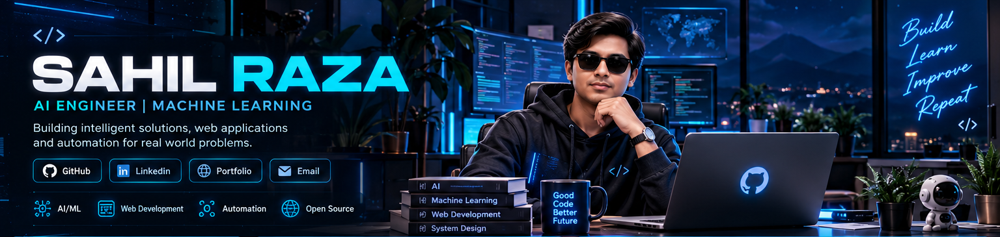

<!-- ====================================================== -->
<!-- SAHIL RAZA | PREMIUM AI ENGINEER GITHUB PROFILE        -->
<!-- ====================================================== -->

 

  

**AI ENGINEER · MACHINE LEARNING · SOFTWARE DEVELOPMENT**

*Building intelligent solutions for real-world problems.*

 

---

## ◈ 01 — ABOUT ME

### Hey there! I'm Sahil Raza 👋

**AI Engineer | Machine Learning | Full-Stack Developer**

*Curious mind. Creative builder. Technology enthusiast.*

I'm passionate about exploring how technology can solve meaningful real-world problems. My journey revolves around **Artificial Intelligence, Machine Learning, and Software Development**, where I enjoy transforming ideas into intelligent, practical applications.

I believe great engineering is not just about writing code — it's about understanding problems, thinking creatively, and building solutions that make a difference.

### 🚀 What Drives Me

- 🤖 **Artificial Intelligence:** Exploring intelligent systems and real-world AI applications.
- 🧠 **Machine Learning:** Experimenting with models, data, and predictive technologies.
- ⚡ **Generative AI:** Exploring LLMs, AI agents, and intelligent automation.
- 💻 **Software Development:** Building modern web applications and scalable solutions.
- 🔬 **Innovation:** Turning creative ideas into practical projects through experimentation.

### 🎯 What I'm Working Towards

Continuously strengthening my engineering skills, building impactful products, contributing to meaningful projects, and exploring the future of AI.

**"Think beyond possibilities. Build beyond expectations."**

---

## ◈ 02 — TECH ARSENAL

### Programming Languages

### AI & Machine Learning

### Frameworks & Development

### Databases & Developer Tools

---

## ◈ 03 — FEATURED PROJECTS

<table>
<tr>
<td width="50%" valign="top">

### 🌱 Farmer AI

An intelligent agriculture platform focused on helping farmers make better decisions using technology.

**Focus Areas**
- AI-based crop recommendations
- Soil and weather analysis
- Smart farming solutions

**Tech:** Python · Machine Learning · AI

</td>
<td width="50%" valign="top">

### 🤖 AIML

A collection of Artificial Intelligence and Machine Learning learning projects and experiments.

**Focus Areas**
- Python programming
- AI and ML concepts
- Practical implementations

**Tech:** Python · AI · ML

 

<a href="https://github.com/Sahil8548/AIML">Explore Repository →</a>

</td>
</tr>

<tr>
<td width="50%" valign="top">

### ⚖️ Tender AI

An AI-powered platform concept for tender analysis and bidding assistance.

**Focus Areas**
- Tender document analysis
- Intelligent assistance
- Workflow automation

**Tech:** Next.js · Supabase · AI

</td>
<td width="50%" valign="top">

### 🏫 PCM International School

A school website project designed to deliver a modern digital experience.

**Focus Areas**
- Responsive website
- Modern user interface
- School information platform

**Tech:** HTML · CSS · JavaScript

<a href="https://github.com/Sahil8548/pcminternationalschool">Explore Repository →</a>

</td>
</tr>

<tr>
<td width="50%" valign="top">

### 🌦️ Live Weather

A weather application concept for displaying weather information.

**Focus Areas**
- Weather information
- API integration
- Interactive interface

**Tech:** HTML · CSS · JavaScript

<a href="https://github.com/Sahil8548/Live-weather">Explore Repository →</a>

</td>
<td width="50%" valign="top">

### 💻 More Experiments

Explore my other coding projects, experiments and development work.

</td>
</tr>
</table>

---

---

## ◈ 04 — GITHUB ANALYTICS

  

---

## ◈ 05 — CURRENT FOCUS

| DOMAIN | CURRENT FOCUS |
|:---|:---|
| Artificial Intelligence | Intelligent applications |
| Machine Learning | Model development |
| Generative AI | LLMs and AI agents |
| Automation | Smart workflows |
| Full-Stack Development | Modern web applications |
| Backend Development | APIs and databases |

---

## ◈ 06 — BEYOND THE CODE

  

**BUILD SOMETHING. BREAK SOMETHING. LEARN SOMETHING.**

*The best way to predict the future is to build it.*

---

## ◈ 07 — LET'S CONNECT

### Let's Connect & Build Something Amazing! 🚀

*Always open to connecting with developers, innovators and technology enthusiasts.*

 

  

&nbsp;

&nbsp;

  

**Thanks for visiting my profile!**

*Think. Build. Innovate. Repeat.*

